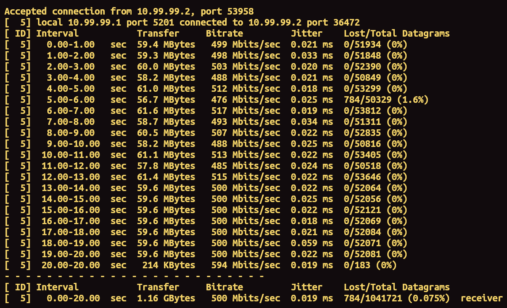

# micro — secure high-speed tunnel over UDP


# What is micro?

**micro** is a simple, UDP tunneling engine written in Go, micro uses TUN interfaces for read/write L3 traffic, encryption - ChaCha20-Poly1305. TUN library used:  https://github.com/songgao/water

# Simple start

Download archives from releases, unzip. Create a valid configs for server and client. Firstly start a server, then a client (at the now version client and server can has connectivity problem - just restart server and client).

```
chmod +x server
sudo ./server
```

```
chmod +x client
sudo ./client
```

# Home network test (iperf3)

## Server side



# TODOs
1) Multiple descriptors for connections (REUSE_PORT connection)
2) TCP version
3) Crushing and collecting packets (only on TCP)